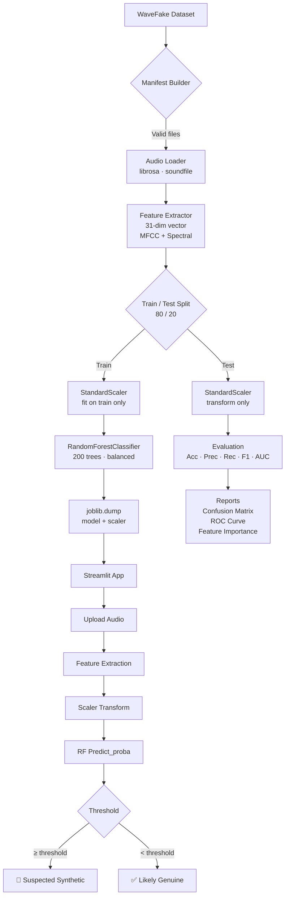

# AI-Powered Real-Time Detection and Prevention of Voice Cloning Impersonation Attacks Using Machine Learning

> **Academic Mini-Project** | Supervised Classification · Random Forest · WaveFake · Streamlit

---

## Table of Contents

1. [Problem Statement](#problem-statement)
2. [Objectives and Scope](#objectives-and-scope)
3. [Proposed Methodology](#proposed-methodology)
4. [Architecture Diagram](#architecture-diagram)
5. [Technology Stack](#technology-stack)
6. [Feature Engineering Explained](#feature-engineering-explained)
7. [Random Forest — Why It Fits](#random-forest--why-it-fits)
8. [Project Structure](#project-structure)
9. [Quick Start](#quick-start)
10. [Dataset Setup](#dataset-setup)
11. [Training the Model](#training-the-model)
12. [Running the App](#running-the-app)
13. [Evaluation Methodology](#evaluation-methodology)
14. [Test Cases](#test-cases)
15. [Cybersecurity Features](#cybersecurity-features)
16. [Limitations and Future Scope](#limitations-and-future-scope)

---

## Problem Statement

Voice cloning (text-to-speech synthesis / voice conversion) has reached a level of perceptual quality indistinguishable from genuine speech in many settings. Adversaries exploit this to:

- **Impersonate executives** in phone-based CEO-fraud attacks
- **Bypass voice biometric authentication** systems
- **Fabricate audio evidence** in legal or journalistic contexts

Existing rule-based or signal-level detection heuristics are brittle against modern neural vocoders. A data-driven machine learning approach trained on diverse synthetic voices generalises better.

---

## Objectives and Scope

| Objective | Description |
|-----------|-------------|
| Binary classification | Classify any audio clip as **Genuine** or **Suspected Synthetic** |
| Feature-based detection | Use 31 hand-crafted acoustic features (no raw-waveform deep learning) |
| Supervised learning | Train exclusively with `RandomForestClassifier` (scikit-learn) |
| Real-time inference | Sub-second prediction on uploaded audio files |
| Explainability | Feature importance ranking to explain model decisions |
| Defensive tooling | Cybersecurity warnings, configurable threshold, local prediction history |

**Out of scope:** Real-time audio streaming, speaker diarisation, adversarial robustness, production deployment, cloud services.

---

## Proposed Methodology



---

## Architecture Diagram

```
voice-cloning-machine-learning/
│
├── app.py                    # Streamlit UI (6 pages)
├── config.py                 # Single source of truth for all parameters
├── requirements.txt
├── README.md
│
├── data/
│   ├── README.md             # Dataset download instructions
│   ├── WaveFake/             # ← place extracted dataset here
│   └── processed/
│       ├── dataset_manifest.csv
│       └── prediction_history.csv
│
├── models/
│   ├── rf_voice_cloning.joblib
│   ├── feature_scaler.joblib
│   └── feature_config.json
│
├── reports/
│   ├── confusion_matrix.png
│   ├── feature_importance.png
│   ├── roc_curve.png
│   └── metrics.json
│
├── src/
│   ├── utils.py              # Logging, JSON, Timer, filesystem helpers
│   ├── audio_features.py     # load_audio(), extract_features(), get_audio_info()
│   ├── dataset_loader.py     # build_manifest(), get_valid_splits(), dataset_summary()
│   ├── train_model.py        # train(), load_model(), model_is_trained()
│   ├── evaluate_model.py     # evaluate(), plot helpers
│   └── predict.py            # predict(), load_history()
│
└── tests/
    └── test_features.py      # pytest test suite
```

---

## Technology Stack

| Component | Library / Tool | Purpose |
|-----------|---------------|---------|
| Audio I/O | `librosa`, `soundfile` | Load, resample, mono conversion |
| Feature extraction | `librosa` | MFCC, spectral features, ZCR, RMS |
| ML model | `scikit-learn` | `RandomForestClassifier`, `StandardScaler` |
| Model persistence | `joblib` | Save / load model and scaler |
| Data manipulation | `pandas`, `numpy` | Manifest, feature matrices |
| Visualisation | `matplotlib`, `seaborn` | All plots |
| Web UI | `streamlit` | Interactive application |
| Progress | `tqdm` | Feature extraction progress bars |

---

## Feature Engineering Explained

### MFCC (Mel-Frequency Cepstral Coefficients)

MFCCs model the short-term spectral envelope of speech on a perceptually motivated (mel) frequency scale. Synthesised speech often has subtle MFCC anomalies (flatter distribution, unusual temporal dynamics) compared to natural recordings.

- **13 MFCC means** — average spectral shape across the clip
- **13 MFCC standard deviations** — spectral variability (synthetic speech often shows reduced variation)

### Spectral Features

| Feature | What it captures |
|---------|-----------------|
| Spectral Centroid | "Centre of mass" of the spectrum — synthesisers often shift this |
| Spectral Bandwidth | Spread around the centroid — GAN artefacts can compress this |
| Spectral Rolloff | Frequency below which 85% of energy lies — measures high-frequency content |
| Zero-Crossing Rate | Rate of sign changes — proxy for noisiness / voicing |
| RMS Energy | Clip loudness — normalisation differences between genuine and synthetic |

**Total: 31 numerical features per audio clip**

---

## Random Forest — Why It Fits

1. **Handles tabular features well** — MFCC + spectral descriptors are numerical and well-scaled after `StandardScaler`.
2. **Robust to irrelevant features** — random subspace selection at each split inherently filters noise.
3. **`class_weight="balanced"`** — compensates for class imbalance without over/under-sampling.
4. **Feature importance** — mean decrease in impurity gives an interpretable ranking.
5. **No hyperparameter sensitivity** — RF is robust with default settings and easy to tune.
6. **Fast inference** — prediction time is milliseconds even with 200 trees.

---

## Quick Start

### 1. Install Dependencies

```bash
cd voice-cloning-machine-learning
pip install -r requirements.txt
```

> **Python 3.9 – 3.12** is recommended. Tested on Windows (PowerShell) and Linux.

### 2. Set Up the Dataset

See [Dataset Setup](#dataset-setup) below.

### 3. Build Manifest

```bash
python -c "from src.dataset_loader import build_manifest; build_manifest(force=True)"
```

### 4. Train the Model

```bash
python -m src.train_model
```

### 5. Run Tests

```bash
pytest tests/ -v
```

### 6. Launch the App

```bash
streamlit run app.py
```

---

## Dataset Setup

1. Go to **https://github.com/RUB-SysSec/WaveFake** and follow the Zenodo download link.
2. Extract the archive so you have:

```
data/WaveFake/
├── LJSpeech-1.1/wavs/
└── generated_audio/
    ├── ljspeech_full_band_melgan/
    ├── ljspeech_hifiGAN/
    ├── ljspeech_melgan/
    ├── ljspeech_melgan_large/
    ├── ljspeech_multi_band_melgan/
    ├── ljspeech_parallel_wavegan/
    └── ljspeech_waveglow/
```

3. If extracted elsewhere, set `WAVEFAKE_ROOT` in `config.py` or export the env var:

```powershell
$env:WAVEFAKE_ROOT = "D:\datasets\WaveFake"
```

---

## Training the Model

### CLI

```bash
python -m src.train_model
```

### Python API

```python
from src.train_model import train

result = train(rf_params={"n_estimators": 300})
print(result["metrics"])
```

### Output artifacts

| File | Description |
|------|-------------|
| `models/rf_voice_cloning.joblib` | Trained `RandomForestClassifier` |
| `models/feature_scaler.joblib`   | Fitted `StandardScaler` |
| `models/feature_config.json`     | Feature names, counts, RF params |
| `reports/metrics.json`           | Full evaluation metrics |
| `reports/confusion_matrix.png`   | Confusion matrix plot |
| `reports/feature_importance.png` | Top feature importances |
| `reports/roc_curve.png`          | ROC curve with AUC |

---

## Running the App

```bash
streamlit run app.py
```

Open **http://localhost:8501** in your browser.

### App Pages

| Page | Description |
|------|-------------|
| 🏠 Home Dashboard | Status, metrics summary, methodology overview |
| 📊 Dataset Analysis | Class distribution, vocoder breakdown, duration stats |
| 🎵 Audio Analysis | Waveform, spectrogram, MFCC heatmap, feature table |
| 🤖 Model Training | Configurable RF training with live progress |
| 🛡️ Voice Cloning Detection | Upload audio → classify with cybersecurity warning |
| 📈 Evaluation Results | Full metrics, confusion matrix, ROC, feature importance |

---

## Evaluation Methodology

- **Split**: 80% train / 20% test (stratified by class label)
- **Leakage prevention**: `StandardScaler` is fit **only** on training data; test set is transformed with training statistics
- **Metrics**: Accuracy, Precision, Recall, F1-Score, ROC-AUC, Confusion Matrix, Classification Report
- **Inference time**: measured on the test set as a batch
- **No fabricated results**: all metrics are computed on genuinely held-out data

---

## Test Cases

| Test | Expected Outcome |
|------|-----------------|
| Valid 1-second sine WAV | Feature vector of length 31, dtype float32, no NaN |
| Stereo WAV file | Successfully mono-converted, features extracted |
| Corrupted / non-audio file | `extract_features` returns `None` gracefully |
| Missing file path | `extract_features` returns `None` gracefully |
| Silent audio file | `load_audio` returns `None` (below amplitude threshold) |
| Feature names list length | `len(FEATURE_NAMES) == N_FEATURES == 31` |
| Label mapping | `LABEL_GENUINE == 0`, `LABEL_SPOOF == 1` |
| Model persistence | Saved model loadable; scaler file present |
| Prediction pre-training | `predict()` returns `success=False` with clear error message |
| Prediction post-training | `predict()` returns `success=True`, probability in [0, 1] |

Run: `pytest tests/ -v`

---

## Cybersecurity Features

- **Binary classification**: Genuine vs Suspected Synthetic
- **Configurable threshold**: Adjust sensitivity (default 0.50)
- **Spoof warnings**: Detailed warning with actionable recommendations
- **Prediction history**: Local CSV log (metadata only — audio never stored by default)
- **Probability display**: Transparent confidence scores
- **Disclaimers**: System never authorises or blocks actions autonomously

---

## Limitations and Future Scope

### Current Limitations

1. **Acoustic features only** — no waveform-level artefact detection; advanced vocoders that mimic spectral properties may evade detection
2. **LJSpeech bias** — trained on a single speaker's voice; generalisation to other speakers requires retraining on diverse data
3. **No streaming support** — batch file upload only
4. **No adversarial robustness** — the model is not hardened against adversarial perturbations
5. **No speaker identification** — the system does not verify who the speaker is, only whether the voice is synthesised

### Future Scope

- Add end-to-end deep features (wav2vec 2.0, HuBERT embeddings) as additional features
- Multi-dataset training (ASVspoof, FakeAVCeleb) for cross-domain generalisation
- Streaming audio buffer classification for real-time call monitoring
- Adversarial training to harden against GAN-based attacks
- Speaker verification integration (two-factor: "is this person, and is this genuine audio?")
- API endpoint for integration with VoIP / PBX systems

---

## Citation

```bibtex
@inproceedings{frank2021wavefake,
  title     = {WaveFake: A Data Set to Facilitate Audio Deepfake Detection},
  author    = {Frank, Joel and Schönherr, Lea},
  booktitle = {NeurIPS Datasets and Benchmarks Track},
  year      = {2021},
  url       = {https://github.com/RUB-SysSec/WaveFake}
}
```

---

*This project is for academic and defensive research purposes only.*
